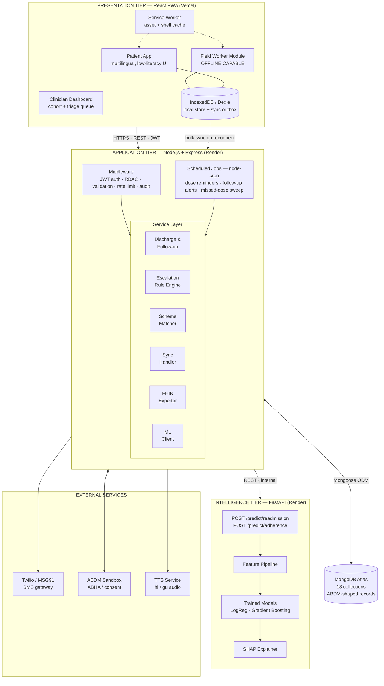
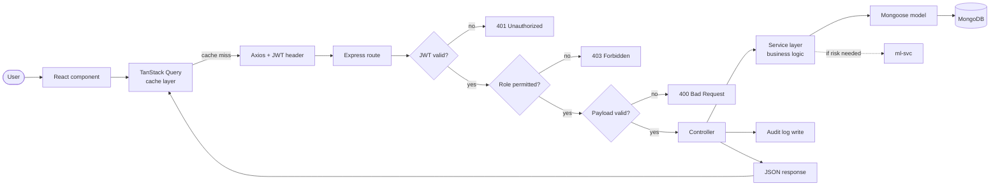
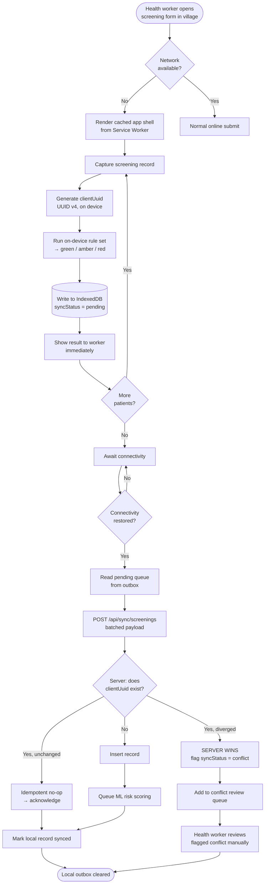
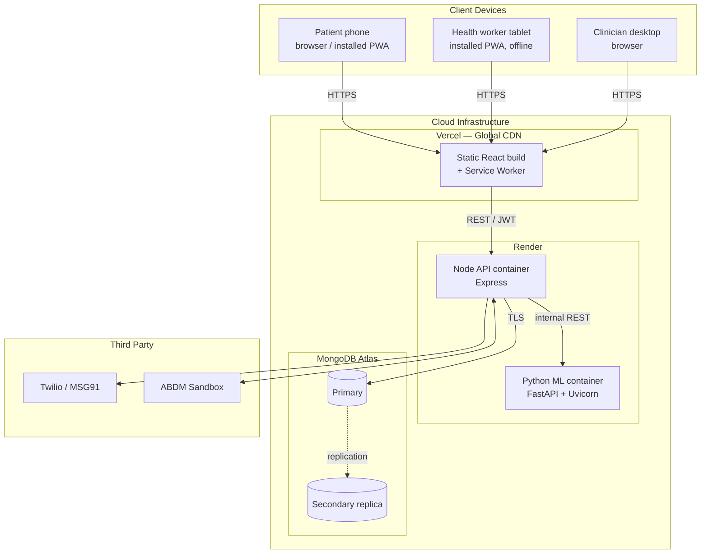
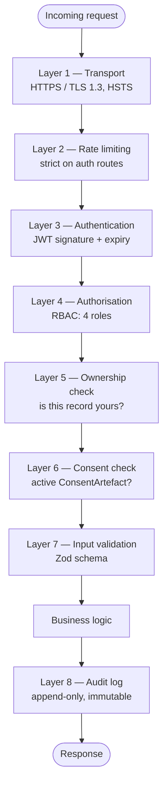

# 2. Architecture Diagram

> Diagrams are written in Mermaid. Paste any block into <https://mermaid.live> to
> export PNG/SVG for the report, or view directly on GitHub.

## 2.1 Architectural Style

DisCharge+ follows a **three-tier, service-oriented architecture** with an
**offline-first presentation tier**.

| Tier | Responsibility | Technology |
|---|---|---|
| Presentation | UI, local persistence, sync queue | React PWA + IndexedDB |
| Application | Business logic, auth, orchestration | Node.js + Express |
| Intelligence | Risk models, explanations | Python + FastAPI |
| Data | Persistence | MongoDB Atlas |

The Application tier is the only component that talks to the database. The
Intelligence tier is stateless — it receives features and returns scores, holding no
patient records of its own. This keeps the ML service independently deployable and
means a failure there degrades risk scoring without affecting core care delivery.

## 2.2 High-Level Architecture

## 2.3 Request Flow — Online Path

Every request passes authentication, authorisation and validation before reaching
business logic, and every record access is written to the audit log. This ordering is
deliberate: validation after authorisation means an unauthenticated caller learns
nothing about the expected payload shape.

## 2.4 Offline Flow — Field Worker Path

The `clientUuid` is the load-bearing element. Because it is generated on the device
before the record ever reaches the network, a retried request resolves to the same
key and the server upserts rather than inserts — so a flaky connection produces one
record, not several.

## 2.5 Deployment Architecture

## 2.6 Security Architecture

Layer 5 is the one that matters most and is easiest to omit. A valid JWT for a
`patient` proves *who* the caller is, not *which records* they may read — without an
explicit ownership check, any authenticated patient could request any other patient's
record by changing an ID in the URL.

## 2.7 Design Decisions

| # | Decision | Alternative rejected | Rationale |
|---|---|---|---|
| A1 | Three separate services | Single Node monolith | ML requires the Python scientific stack; separation gives independent deployment and an explicit contract |
| A2 | Stateless ML service | ML service with its own DB | Avoids a second source of truth for patient data; simplifies consent enforcement |
| A3 | MongoDB | PostgreSQL | Clinical records are heterogeneous and sparsely populated; schema evolves across build stages |
| A4 | JWT | Server-side sessions | Stateless auth across two backend services without shared session storage |
| A5 | Offline-first PWA | Native mobile app | One codebase, no app-store barrier, installable; sufficient for the field use case |
| A6 | Rule engine for escalation, ML for risk | ML for both | Escalation must be auditable and explainable per rule; a missed red flag is not an acceptable model error |
| A7 | Server-wins conflict resolution | Last-write-wins | Device clocks are unreliable; clinical data must never be silently overwritten |
