# 3. E-R, Use-Case, Activity and Sequence Diagrams

> All diagrams are Mermaid. Paste into <https://mermaid.live> to export PNG/SVG.
> Source of truth for entities and attributes: [`data-model.md`](./data-model.md).

---

# 3.1 Entity-Relationship Diagram

## 3.1.1 Notation

Crow's-foot notation, logical relational view.

| Symbol | Meaning |
|---|---|
| `||--o{` | One-to-many (one mandatory, many optional) |
| `||--||` | One-to-one (both mandatory) |
| `||--o|` | One-to-zero-or-one |
| `}o--||` | Many-to-one |
| PK / FK | Primary key / Foreign key |

**Note on the physical model:** the implementation database is MongoDB, a document
store. This ERD presents the *logical* model. Physically, each entity is its own
collection and foreign keys are `ObjectId` references resolved via `$lookup` or
Mongoose `populate`. Two attributes (`patientId` on `FollowUp`, `AdherenceRecord`
and `Escalation`) are deliberately denormalised for cohort-query performance.

## 3.1.2 Core ERD — Clinical Care Path

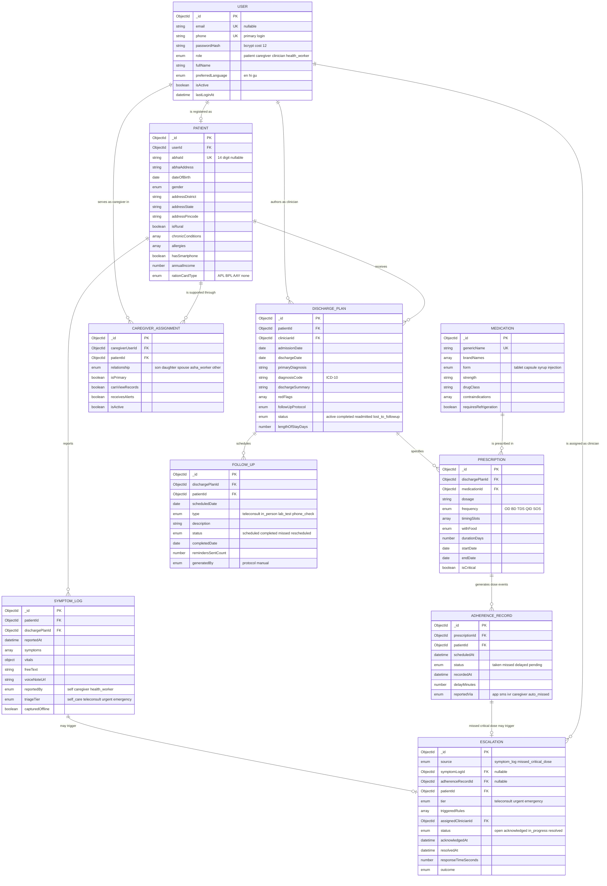

## 3.1.3 Supporting ERD — Intelligence, Education, Schemes, Offline, Compliance

```mermaid
erDiagram
    PATIENT ||--o{ RISK_ASSESSMENT : "is scored in"
    DISCHARGE_PLAN ||--o{ RISK_ASSESSMENT : "provides context for"
    PATIENT ||--o{ SCHEME_ELIGIBILITY_CHECK : "is checked for"
    SCHEME ||--o{ SCHEME_ELIGIBILITY_CHECK : "is evaluated in"
    PATIENT ||--o{ SCREENING_RECORD : "is screened in"
    USER ||--o{ SCREENING_RECORD : "is captured by health worker"
    PATIENT ||--o{ CONSENT_ARTEFACT : "grants"
    USER ||--o{ CONSENT_ARTEFACT : "is granted"
    USER ||--o{ NOTIFICATION : "receives"
    USER ||--o{ AUDIT_LOG : "acts in"
    PATIENT ||--o{ AUDIT_LOG : "is subject of"
    USER ||--o{ EDUCATION_CONTENT : "reviews as clinician"

    RISK_ASSESSMENT {
        ObjectId _id PK
        ObjectId patientId FK
        ObjectId dischargePlanId FK
        enum modelType "readmission adherence"
        string modelVersion "semver"
        number riskScore "0.0 to 1.0"
        enum riskBand "low moderate high"
        number thresholdUsed
        array topFactors "SHAP values"
        object featureSnapshot
        datetime assessedAt
    }

    EDUCATION_CONTENT {
        ObjectId _id PK
        string contentKey
        array conditionCodes "ICD-10"
        enum language "en hi gu"
        string title
        string body
        number readingLevel "1 to 12"
        string audioUrl
        enum source "curated llm_generated"
        enum reviewStatus "draft clinician_reviewed published"
        ObjectId reviewedBy FK
    }

    SCHEME {
        ObjectId _id PK
        string schemeCode UK
        string name
        enum level "central state"
        array applicableStates
        number coverageAmount
        array eligibilityRules
        array requiredDocuments
        boolean isActive
    }

    SCHEME_ELIGIBILITY_CHECK {
        ObjectId _id PK
        ObjectId patientId FK
        ObjectId schemeId FK
        boolean isEligible
        array criteriaResults "per-criterion explanation"
        datetime checkedAt
    }

    SCREENING_RECORD {
        ObjectId _id PK
        string clientUuid UK "idempotency key"
        ObjectId healthWorkerId FK
        ObjectId patientId FK "nullable until matched"
        string campLocation
        datetime capturedAt "device time"
        datetime syncedAt "server time"
        enum syncStatus "pending synced conflict failed"
        object screeningData
        enum offlineRiskFlag "green amber red"
        enum conflictResolution "server_wins_flagged"
        ObjectId conflictReviewedBy FK
    }

    CONSENT_ARTEFACT {
        ObjectId _id PK
        ObjectId patientId FK
        ObjectId grantedToUserId FK
        enum purpose "care_management emergency research"
        array dataCategories
        date validFrom
        date validUntil
        enum status "active revoked expired"
        datetime revokedAt
    }

    NOTIFICATION {
        ObjectId _id PK
        ObjectId recipientUserId FK
        enum channel "sms push whatsapp ivr"
        enum purpose "med_reminder followup_reminder escalation_alert"
        string relatedEntityType
        ObjectId relatedEntityId
        enum language "en hi gu"
        string body
        enum status "queued sent delivered failed"
        string providerMessageId
    }

    AUDIT_LOG {
        ObjectId _id PK
        ObjectId actorUserId FK
        enum action "read create update delete export login_fail"
        string resourceType
        ObjectId resourceId
        ObjectId patientId FK
        string ipAddress
        datetime occurredAt "immutable"
    }
```

## 3.1.4 Relationship Summary

| # | Parent | Child | Cardinality | Participation | Note |
|---|---|---|---|---|---|
| R1 | User | Patient | 1 : 0..1 | Partial | Only role=patient |
| R2 | User | CaregiverAssignment | 1 : 0..N | Partial | M:N leg |
| R3 | Patient | CaregiverAssignment | 1 : 0..N | Partial | M:N leg |
| R4 | Patient | DischargePlan | 1 : 0..N | Partial | Multiple admissions |
| R5 | User (clinician) | DischargePlan | 1 : 0..N | Partial | Authorship |
| R6 | DischargePlan | Prescription | 1 : 0..N | Total on child | M:N leg |
| R7 | Medication | Prescription | 1 : 0..N | Partial | M:N leg |
| R8 | DischargePlan | FollowUp | 1 : 0..N | Total on child | Protocol-generated |
| R9 | Prescription | AdherenceRecord | 1 : 0..N | Total on child | One per due dose |
| R10 | Patient | SymptomLog | 1 : 0..N | Partial | — |
| R11 | SymptomLog | Escalation | 1 : 0..1 | Partial | Only if a rule fires |
| R12 | AdherenceRecord | Escalation | 1 : 0..1 | Partial | Only if `isCritical` missed |
| R13 | User (clinician) | Escalation | 1 : 0..N | Partial | Queue assignment |
| R14 | Patient | RiskAssessment | 1 : 0..N | Partial | Versioned over time |
| R15 | Patient | SchemeEligibilityCheck | 1 : 0..N | Partial | Per scheme, per check |
| R16 | Scheme | SchemeEligibilityCheck | 1 : 0..N | Partial | — |
| R17 | User (health worker) | ScreeningRecord | 1 : 0..N | Total on child | — |
| R18 | Patient | ConsentArtefact | 1 : 0..N | Partial | — |
| R19 | User | Notification | 1 : 0..N | Partial | — |
| R20 | User | AuditLog | 1 : 0..N | Partial | Append-only |

**Many-to-many relationships resolved by junction entities: 2**
- `DischargePlan` ↔ `Medication` via `Prescription`
- `User` (caregiver) ↔ `Patient` via `CaregiverAssignment`

---

# 3.2 Use-Case Diagram

## 3.2.1 Actors

| Actor | Type | Description |
|---|---|---|
| Patient | Primary | Discharged individual under monitoring |
| Caregiver | Primary | Family member or ASHA worker acting for a patient |
| Clinician | Primary | Doctor authoring plans and handling escalations |
| Health Worker | Primary | Field operator conducting village screening |
| System Scheduler | Secondary | Automated cron process (non-human) |
| ML Service | Secondary | Risk scoring subsystem |
| SMS Gateway | Secondary | External notification provider |
| ABDM Gateway | Secondary | External health-identity provider |

## 3.2.2 System-Level Use-Case Diagram

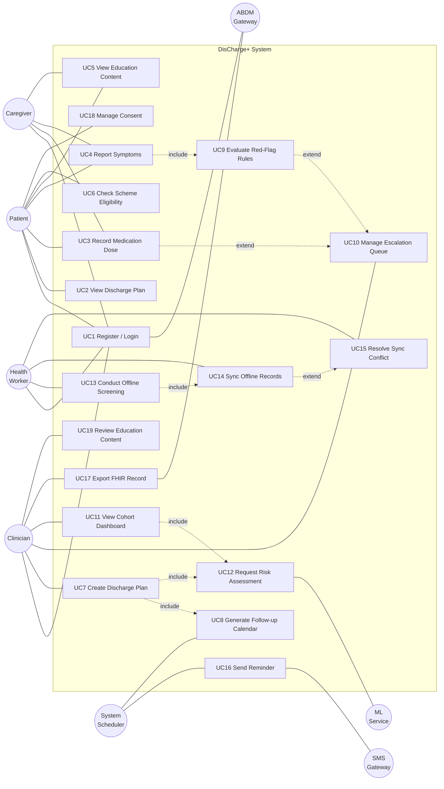

## 3.2.3 Use-Case Specifications (key cases)

### UC4 — Report Symptoms

| Element | Detail |
|---|---|
| **Actors** | Patient (primary), Caregiver (alternate) |
| **Precondition** | Authenticated; an active DischargePlan exists |
| **Trigger** | Patient feels unwell, or responds to a scheduled check-in |
| **Main flow** | 1. Select symptoms from icon grid. 2. Set severity 1–5. 3. Optionally enter vitals. 4. Optionally record a voice note. 5. Submit. 6. System evaluates red-flag rules (UC9). 7. System stores `triageTier`. 8. Guidance shown in the patient's language. |
| **Alternate A1** | Patient is offline → record queued locally, on-device rules give provisional guidance |
| **Alternate A2** | Caregiver reports on behalf → `reportedBy = caregiver` |
| **Extension** | If tier ≥ `urgent`, UC10 is invoked |
| **Postcondition** | `SymptomLog` persisted; `Escalation` created if triggered |
| **Outcome served** | 2 — Automated Escalation |

### UC9 — Evaluate Red-Flag Rules

| Element | Detail |
|---|---|
| **Actors** | System (invoked by UC4) |
| **Precondition** | A SymptomLog has been submitted |
| **Main flow** | 1. Load `redFlags` from the patient's DischargePlan. 2. Load protocol rule set by `followUpProtocol`. 3. Evaluate each rule against symptoms and vitals. 4. Collect all matching rule IDs. 5. Assign tier = highest severity matched. 6. Record `triggeredRules` for explainability. |
| **Business rule** | Where rules conflict, the **highest** severity always wins — false positives are preferred to false negatives |
| **Postcondition** | `triageTier` set; `Escalation` created when tier ≥ teleconsult |

### UC14 — Sync Offline Records

| Element | Detail |
|---|---|
| **Actors** | Health Worker, System |
| **Precondition** | Records exist locally with `syncStatus = pending`; connectivity restored |
| **Main flow** | 1. Detect connectivity. 2. Read outbox. 3. POST batch to `/api/sync/screenings`. 4. Server upserts on `clientUuid`. 5. Server returns per-record status. 6. Client marks synced and clears outbox. |
| **Alternate A1** | Record exists and has diverged → server value retained, `syncStatus = conflict` (UC15) |
| **Alternate A2** | Network drops mid-sync → exponential backoff retry; idempotency prevents duplicates |
| **Postcondition** | All records either synced or flagged; no duplicates created |
| **Outcome served** | 6 — Offline Field Capabilities |

---

# 3.3 Activity Diagrams

## 3.3.1 Discharge Plan Creation and Follow-up Generation

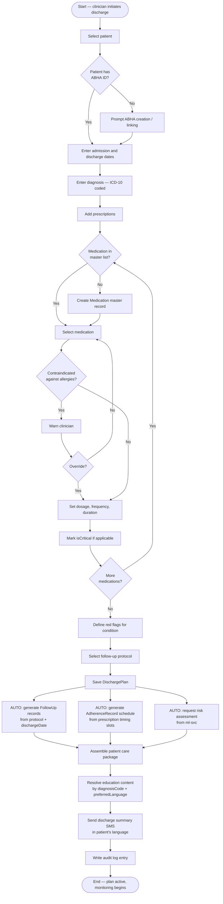

## 3.3.2 Symptom Reporting and Escalation

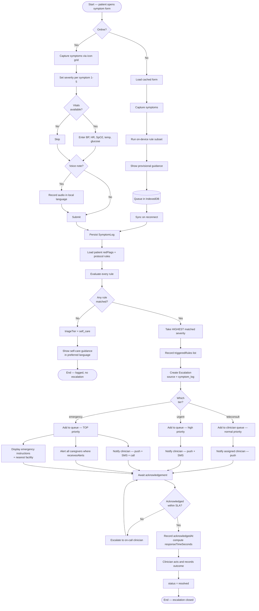

## 3.3.3 Offline Screening and Conflict Resolution

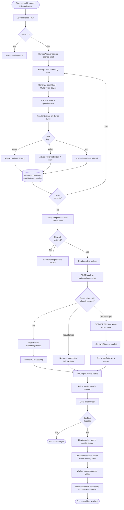

## 3.3.4 Scheme Eligibility Check

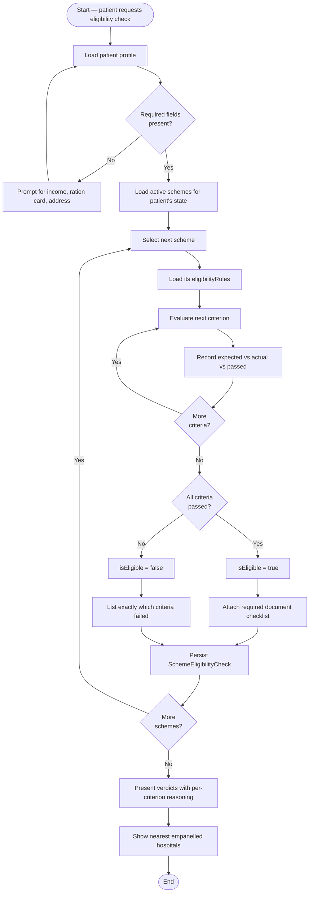

---

# 3.4 Sequence Diagrams

## 3.4.1 Authentication

```mermaid
sequenceDiagram
    actor U as User
    participant C as React Client
    participant A as Express API
    participant M as Auth Middleware
    participant DB as MongoDB

    U->>C: Enter phone + password
    C->>C: Client-side format validation
    C->>+A: POST /api/auth/login
    A->>A: Rate-limit check
    alt Limit exceeded
        A-->>C: 429 Too Many Requests
    else Within limit
        A->>+DB: findOne({ phone })
        DB-->>-A: User document
        alt User not found
            A->>DB: Write AuditLog (login_fail)
            A-->>C: 401 Invalid credentials
        else Found
            A->>A: bcrypt.compare(password, passwordHash)
            alt Mismatch
                A->>DB: Write AuditLog (login_fail)
                A-->>C: 401 Invalid credentials
            else Match
                A->>A: Sign access JWT (15 min)
                A->>A: Sign refresh token (7 days)
                A->>DB: Store refreshTokenHash, update lastLoginAt
                A->>DB: Write AuditLog (login success)
                A-->>-C: 200 { accessToken, refreshToken, role }
            end
        end
    end
    C->>C: Store tokens; route by role
    C-->>U: Render role-appropriate dashboard

    Note over C,A: Subsequent requests carry Authorization: Bearer <token>
    C->>+A: GET /api/patients/:id
    A->>+M: Verify JWT
    M->>M: Check signature and expiry
    M->>M: Check role permits resource
    M->>M: Check caller owns / is consented to record
    M-->>-A: Attach req.user
    A->>DB: Fetch record
    A->>DB: Write AuditLog (read)
    A-->>-C: 200 Patient record
```

## 3.4.2 Symptom Report to Clinician Escalation

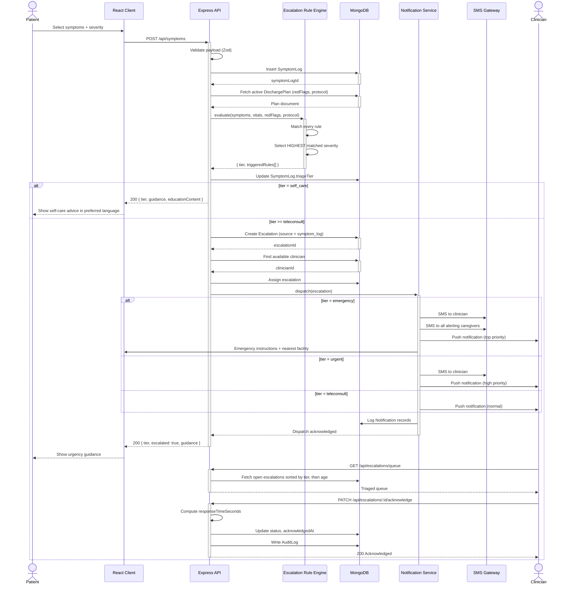

## 3.4.3 Risk Assessment via ML Service

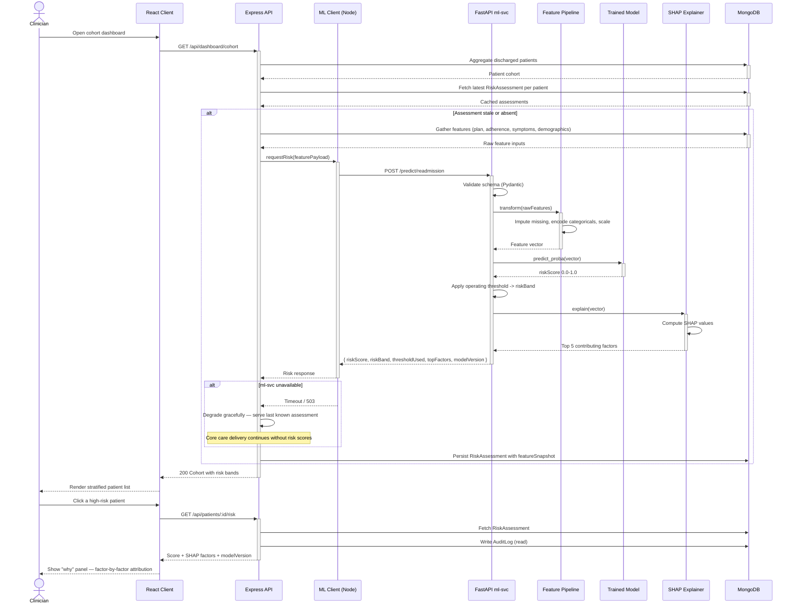

## 3.4.4 Offline Capture and Bulk Sync

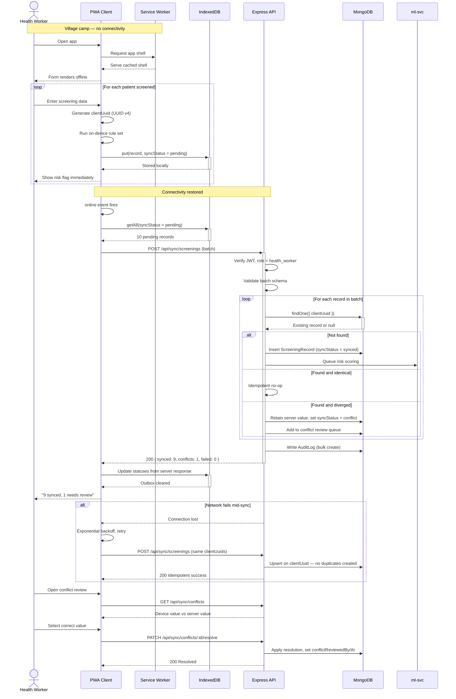

## 3.4.5 Medication Reminder and Missed-Dose Escalation

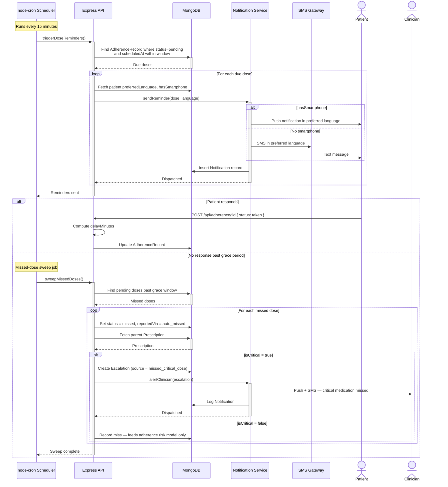
