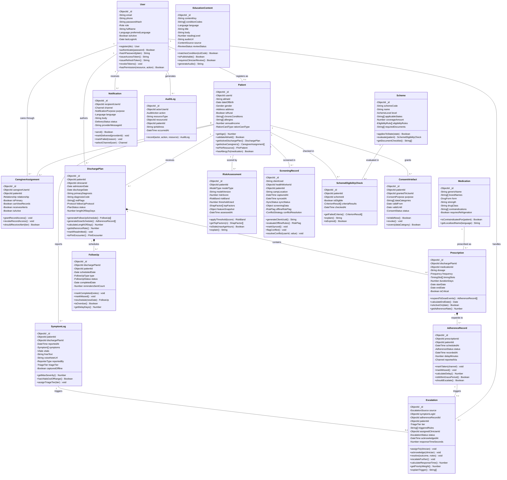
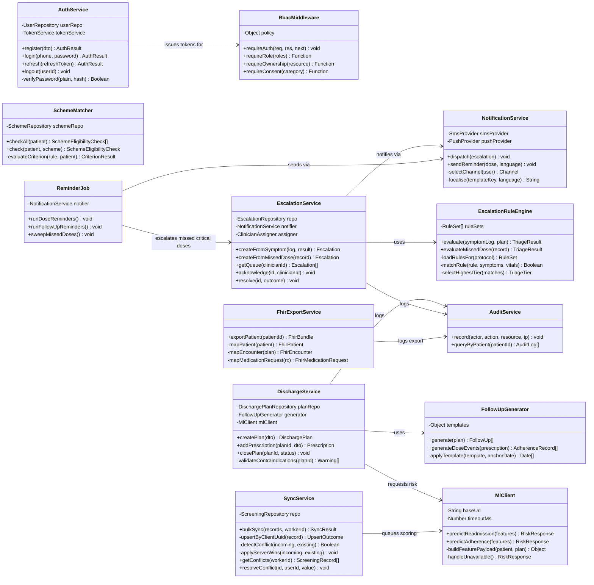
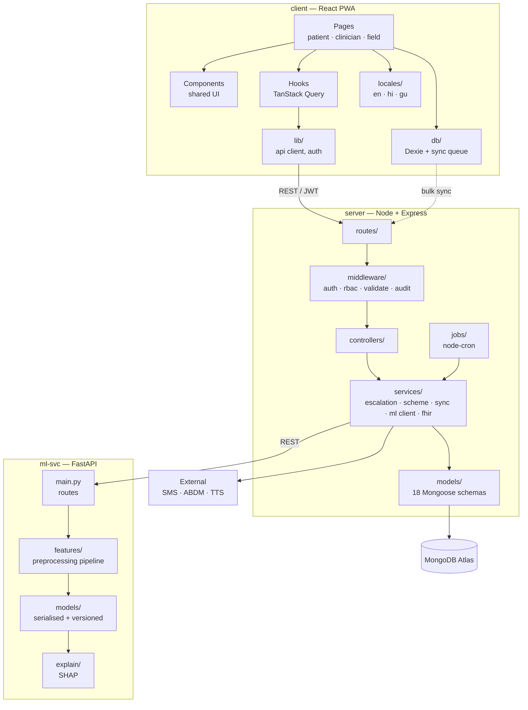
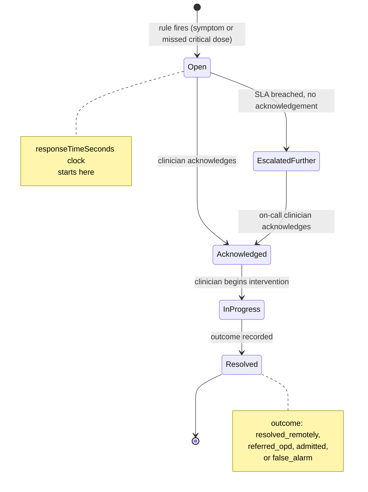
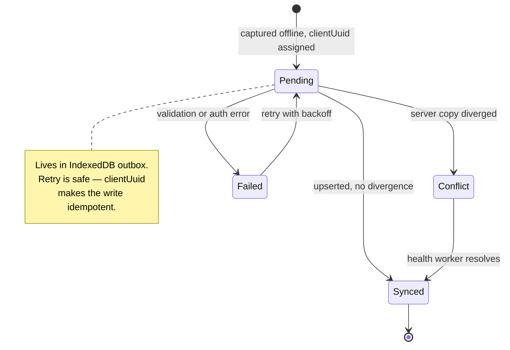
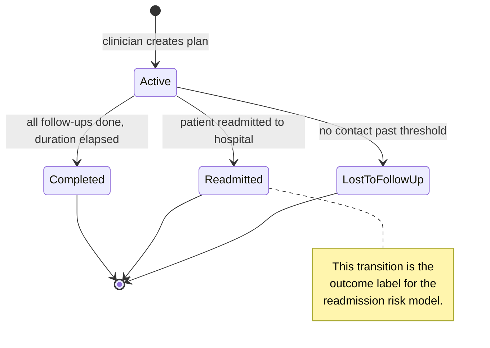
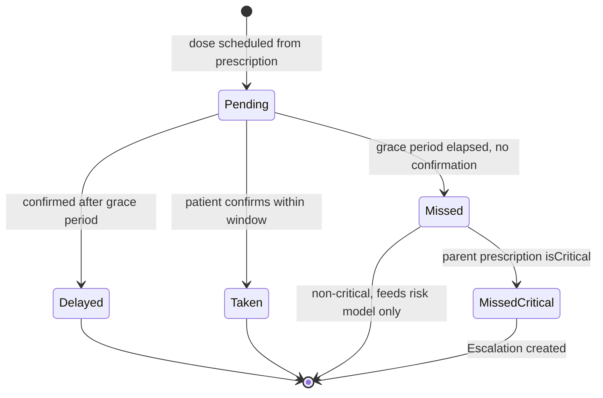
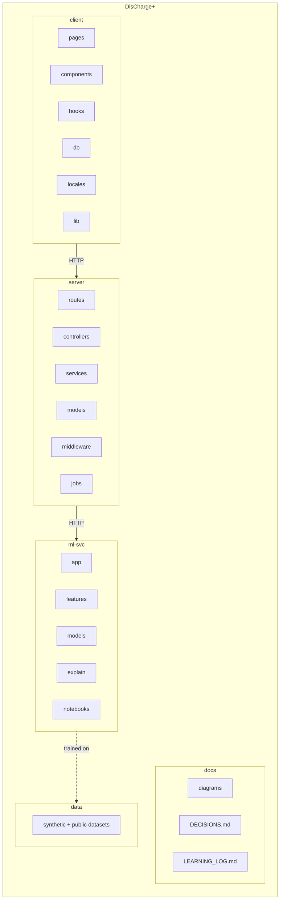

# 4. UML Diagrams

> Mermaid source. Paste into <https://mermaid.live> to export PNG/SVG.

---

# 4.1 Class Diagram — Domain Model

Where the ERD (§3.1) shows *data at rest*, the class diagram adds **behaviour** —
the operations each entity is responsible for.

**Composition vs association:** `DischargePlan *-- Prescription`, `*-- FollowUp`
and `Prescription *-- AdherenceRecord` are **compositions** (filled diamond) — the
child cannot exist without its parent and is deleted with it. Everything else is a
plain association: a `Medication` outlives any prescription referencing it, and a
`Patient` outlives any individual plan.

---

# 4.2 Class Diagram — Service Layer

---

# 4.3 Component Diagram

---

# 4.4 State Diagrams

## 4.4.1 Escalation Lifecycle

## 4.4.2 Screening Record Sync Lifecycle

## 4.4.3 Discharge Plan Lifecycle

## 4.4.4 Adherence Record Lifecycle

---

# 4.5 Package Diagram

